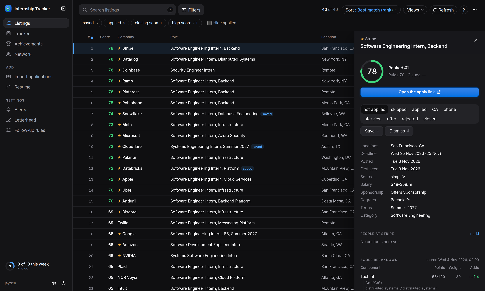
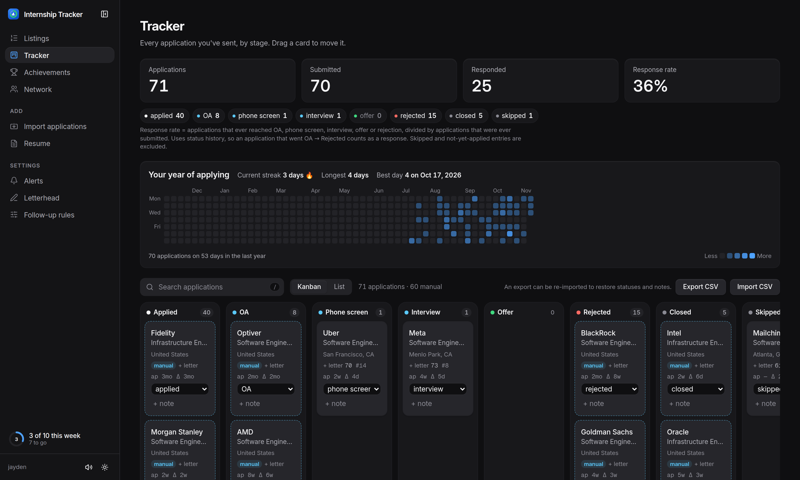
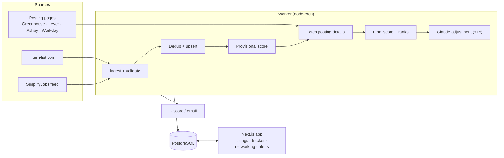

# Internship Tracker

A self-hosted web app that collects software engineering internship postings from public sources, removes duplicates, ranks every listing 0–100 against my own profile, and tracks each application from the first look to an offer.

I built it for my own Summer 2027 search. It runs on my home server as two containers, a Next.js web app and a scheduled background worker, behind Traefik and Authelia.

**Stack:** Next.js 16 (App Router) · React 19 · TypeScript · Tailwind CSS v4 · Prisma 7 · PostgreSQL · node-cron · Vitest · Docker



<p align="center"><sub>Screenshots use demo data.</sub></p>

## Why I built it

Internship postings for a single cycle run into the thousands, spread across GitHub lists, job boards and company career pages. Most of them aren't a good fit, the same role shows up three times under slightly different titles, and the good ones close fast. I was keeping all of this in a spreadsheet and it stopped working, so I built the tool I actually wanted. It finds the roles, tells me which ones are worth my time and why, and keeps track of where every application stands.

The app finds, ranks and organizes. It never applies to jobs, fills in forms, sends messages or stores credentials for job sites. Every application is done by hand.

## What it does

- **Ingestion.** Every day the worker pulls new postings from the [SimplifyJobs](https://github.com/SimplifyJobs/Summer2027-Internships) feed and intern-list.com, removes duplicates, and fetches the full posting from the company's applicant tracking system (Greenhouse, Lever, Ashby, Workday and others) for the listings that look promising.
- **Ranking.** Each listing gets a 0–100 score from a rule-based engine, with an optional Claude pass that reads the posting and adjusts the score by at most ±15. Every score comes with a full breakdown of where its points came from.
- **Application tracking.** A kanban board and list view, status history, notes, bulk CSV import and export, a dashboard, and a heatmap of the year.
- **Resume matching and cover letters.** Shows which keywords from a posting my resume covers and which it misses, and drafts a cover letter from the posting and my resume that I edit before exporting it as a PDF or Word file.
- **Networking.** A contact log tied to companies, with follow-up dates worked out from the outreach history, and a record of who referred me where.
- **Alerts.** A daily Discord and email digest of new high-scoring roles, follow-ups that are due, and saved listings about to close.
- **Interface.** A dense, keyboard-driven table (`j`/`k`, `/`, `f`, `?`) with filters, saved views, customizable columns, light and dark themes, and a layout that works on a phone.



## Architecture



Each refresh runs as one ordered cycle in [`lib/cycle.ts`](lib/cycle.ts). The full data model, invariants and every setting are documented in [`docs/ARCHITECTURE.md`](docs/ARCHITECTURE.md).

## Design decisions

These are the choices that shaped the project and the reasoning behind each one.

**A cheap score decides what's worth fetching.** Most sources only give a title, company and location, with no description. Fetching every posting page would mean thousands of requests a day, so the cycle scores everything first on what it already has, then fetches full postings only for listings above a threshold, then scores again with the full text. Fetching is rate-limited per host and follows `robots.txt`.

**Dedup would rather miss a duplicate than make a wrong merge.** A missed duplicate costs me a second look at the same role. A wrong merge hides a real role completely, which is much worse. So listings match on a normalized company, title and location key, then by fuzzy title within the same company, but two postings with different requisition IDs or URLs are never merged. I found this out the hard way when three different roles at one company got merged because their job IDs were in the URL's query string instead of its path. Every merge is recorded and can be undone from the UI.

**Scoring is deterministic first and AI second.** The rule-based stage reads its weights from [`config/scoring.json`](config/scoring.json), so I can tune the ranking without touching code or restarting anything, and the same input always gets the same score. The Claude stage is optional and capped at ±15 points, so it can refine a ranking but never override it. It runs at temperature 0, caches each result against a hash of the posting text, and is skipped entirely for listings with no text, so it never pays for a call that only sees a job title.

**Sources are pluggable adapters.** Each source is one file that returns listings validated with Zod. Adding a source means one adapter and one registry entry, with no database migration, and one source failing never stops the others.

**All external data is treated as untrusted.** Source payloads, CSV imports, PDF text and model output are all validated at the boundary, and scraped HTML is sanitized before it's rendered. Raw fetches are stored compressed for a while, so when a parser breaks I can compare it against the exact input it saw.

**Nothing the user wrote gets deleted by accident.** Listings are never deleted, they're marked as likely closed once they disappear from every source. Changing an application's status never drops its notes or cover letter.

**Authentication is delegated.** Authelia handles sign-in in front of the app, and the app checks the forwarded identity against a single-user allowlist that admits nobody if it's unset. Every server action checks the session again on its own, and a test finds every action file automatically, so adding an unguarded action fails the test suite.

## How I use AI on this project

I used Claude Code while building this, the same way I'd use any other developer tool. Specifically, it handled the tedious parts: boilerplate, repetitive test cases, parsing fixtures, refactors that touch a lot of files, and first drafts of documentation. I made the decisions. The architecture, the data model, the scoring approach, the dedup rules and the tradeoffs above came from me, and I wrote them down in [`CLAUDE.md`](CLAUDE.md) as fixed rules the AI has to follow instead of revisit.

I read every line of code it writes before it gets committed. If I can't explain what a change does and why, it doesn't go in. A lot of my time went into catching things the AI got wrong or made more complicated than they needed to be, and asking for simpler versions. The test suite is part of that check too, every feature lands with tests, and nothing is merged with a failing test.

So AI saved me a lot of typing, but it's a tool, not the author. I'd rather understand a smaller amount of code completely than ship a lot of code I can't explain.

## Testing

The project has over 1,300 [Vitest](https://vitest.dev) tests, covering:

- source parsers, run against real captured payloads in [`tests/fixtures/`](tests/fixtures/);
- deduplication, scoring, follow-up scheduling, alerts and CSV import;
- integration tests against a real Postgres schema;
- UI components and interactions.

Tests never touch the network. Integration tests only run against a database schema set aside for testing, and refuse to run against anything else.

```bash
npm test          # full suite
npm run lint      # ESLint
```

## Running locally

Requires Node.js 22+ and PostgreSQL.

```bash
npm ci
cp .env.example .env      # set DATABASE_URL (with ?schema=public) and ALLOWED_USER
npx prisma migrate dev    # create the schema
npm run dev               # app on http://localhost:3000
npm run worker            # scheduled ingestion, scoring and alerts
```

[`.env.example`](.env.example) documents every variable. The Claude features are optional. Without credentials, scoring uses the rule-based stage only and drafting is turned off.

Locally there's no Authelia in front of the app, so every request needs a `Remote-Email` header matching `ALLOWED_USER`. A small local proxy that adds it is the easiest way.

## Deployment

One Docker image runs both the web app and the worker, deployed as services on my home server's Compose stack behind Traefik. A backup sidecar runs scheduled `pg_dump`s and verifies each one before keeping it. A systemd timer pulls new commits on `main`, backs up the database, rebuilds, waits for the health checks, and rolls back automatically if they fail. See [`docs/DEPLOYMENT.md`](docs/DEPLOYMENT.md).

## Project layout

```
app/          Next.js routes: listings, tracker, achievements, import, resume, alerts, network, cover letters
lib/          ingestion, scoring, applications, resume, alerts, networking, auth
worker/       scheduled jobs and the internal /refresh endpoint
prisma/       schema and migrations
config/       scoring weights, keywords and thresholds
tests/        mirrors lib/; fixtures/ holds captured source payloads
deploy/       Compose services and env template for the host stack
scripts/      backup, restore and backup health check
docs/         architecture, deployment and the networking design
```

## License

[MIT](LICENSE) © 2026 Jayden Mistry
